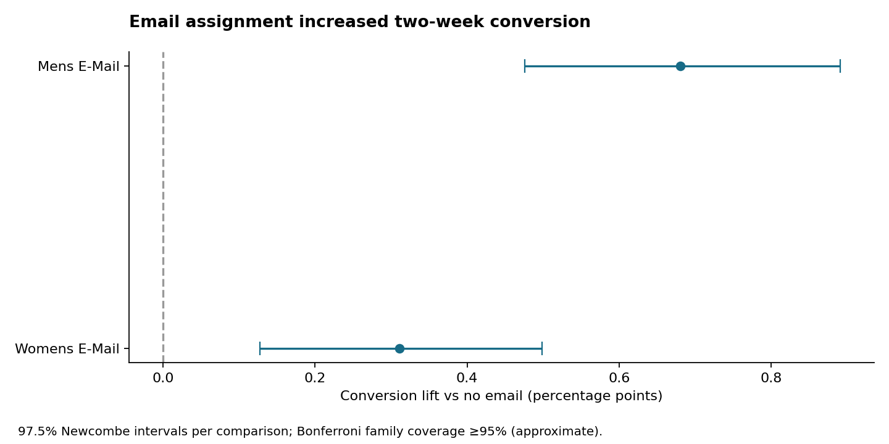
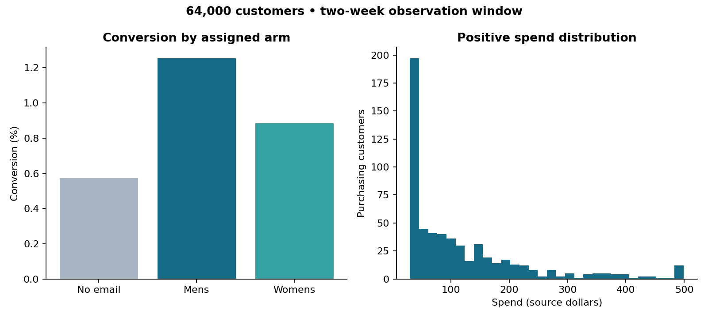

# Hillstrom Email Experiment
### Measuring incremental conversion—not just campaign response

A reproducible analysis of a **64,000-customer randomized email experiment**, built with Python and SQL. This portfolio demonstrates experiment diagnostics, statistical inference, uncertainty communication, and a business decision grounded in incremental outcomes.

## Decision brief
Both email assignments increased two-week purchase conversion relative to no email in this historical sample. Consider a contemporary validation experiment before rollout. Do not equate higher conversion with proven profitability, or infer that one email beats the other from separate comparisons against control.

| Assigned group | Customers | Purchases | Conversion |
|---|---:|---:|---:|
| No email | 21,306 | 122 | 0.573% |
| Mens email | 21,307 | 267 | 1.253% |
| Womens email | 21,387 | 189 | 0.884% |

| Comparison vs no email | Absolute lift | Marginal 95% CI | Holm-adjusted p |
|---|---:|---:|---:|
| Mens email | +0.681 percentage points | [0.501, 0.864] pp | 3.05e-13 |
| Womens email | +0.311 percentage points | [0.150, 0.474] pp | 0.000157 |

Relative lifts are 118.8% and 54.3%; the absolute effects are more useful for planning: about **68 and 31 additional purchases per 10,000 assigned customers**, respectively, under comparable conditions. These are estimated experimental effects, not realized business improvements delivered by this portfolio.



The plot uses wider **97.5% per-comparison intervals**, giving approximate simultaneous coverage of at least 95% across the two comparisons. The table shows marginal 95% intervals; neither interval construction is an exact inversion of the Holm-adjusted test.

## Reproduce
Python 3.12 was used. Run from this directory:

```bash
python -m venv .venv
# macOS/Linux: source .venv/bin/activate
# Windows PowerShell: .venv\Scripts\Activate.ps1
python -m pip install -r requirements.txt
python -m src.download
python -m pytest -q
python -m src.analysis
```

The download checks the CSV SHA-256 and fails if the source changes. No API key is required by the public endpoint at the time of verification. If Kaggle changes access, manually download the linked dataset, place the CSV at `data/hillstrom.csv`, and rerun. Do not bypass a checksum mismatch without investigating.

Outputs are deterministic for the pinned environment, including a fixed bootstrap seed. Raw/cleaned customer records are intentionally excluded from the repository and distribution; the downloader provides reproducibility without asserting redistribution rights.

## What is inside
- `src/analysis.py`: validation, EDA, SRM, baseline balance, primary inference, exploratory revenue, bootstrap, power planning, SQL execution and charts.
- `src/download.py`: public Kaggle download and integrity verification.
- `tests/test_analysis.py`: critical numerical, boundary, schema and duplicate-handling tests.
- `sql/metrics.sql`: auditable customer-level denominators.
- `reports/`: generated tables, figures, audit, and detailed results.
- `docs/methodology.md`: analysis specification, causal assumptions, methods and unresolved issues.
- `docs/business_conclusion.md`: practical recommendation and banking relevance.
- `.github/workflows/tests.yml`: automated unit tests; manual full-data reproduction workflow.

## Data integrity findings
No missing values were found and all 64,000 rows were retained. **6,562 rows repeat an earlier complete profile**, but there is no customer identifier: equal profiles do not establish duplicate people. Automatically dropping them would selectively remove common non-purchasing profiles and distort outcomes. The original `Surburban` spelling is normalized to `Suburban`; no outcomes are modified or imputed.

The 1:1:1 SRM diagnostic gives p=0.903693. This is no evidence of a gross allocation-count mismatch under the assumed allocation model; it does not certify randomization or tracking integrity. See `reports/baseline_balance.csv` for pre-treatment standardized differences.



## Scope and limitations
This is a retrospective reanalysis—not a newly run or prospectively registered experiment. The source reports randomized assignment, but assignment logs, customer IDs, deliverability, costs, margins, unsubscribes, longer-term retention and dates are unavailable. Causal interpretation is conditional on faithful randomization, complete outcome tracking, independent customer units, no interference and an accurate extract. It is not evidence about Canadian banking customers or current campaign performance.

## Sources
- [Kaggle mirror](https://www.kaggle.com/datasets/bofulee/kevin-hillstrom-minethatdata-e-mailanalytics)
- [Kevin Hillstrom's original 2008 experiment description](https://blog.minethatdata.com/2008/03/minethatdata-e-mail-analytics-and-data.html)
- [Statsmodels difference-in-proportions intervals](https://www.statsmodels.org/stable/generated/statsmodels.stats.proportion.confint_proportions_2indep.html)

Analysis executed on 2026-11-15. The public challenge invites analysis; a separate blanket redistribution license was not verified. Attribution is retained and raw data are not bundled.
